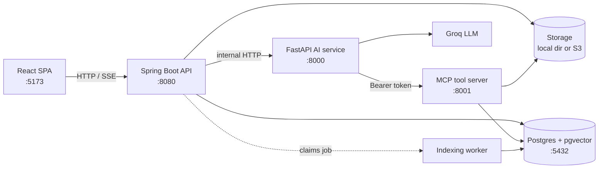

<div align="center">

# codebase-ai

**Ask questions of a codebase, then show your work.**

Upload a repository as a ZIP, and it is indexed into pgvector so that every
answer can cite the file and line it came from.

[](https://github.com/omnavneet/codebase-ai/actions/workflows/ci.yml)


</div>

## What it is

A React workspace over a Spring Boot API that indexes an uploaded codebase into
PostgreSQL + pgvector. Browse the extracted files, search them semantically,
and ask questions in a chat that answers with `file:line` citations. An agent
mode ("Deep investigate") can search, read and follow dependencies on its own.

## Architecture



The browser talks **only** to the backend. The AI service is server-to-server
and is protected by an internal token. Indexing is not a request handler: the
backend writes a row to `indexing_jobs` and a background worker picks it up.

## Key design decisions

**Agent tools live behind an MCP server, and `project_id` is injected
server-side.** The agent discovers the tool server's read-only tools and calls
them over Streamable HTTP; the server adds the project id, so the model can
never choose which project it reads.

**Indexing is a Postgres job queue, not a request thread.** A worker claims a
row with `FOR UPDATE SKIP LOCKED`, transactions stay short, the lease is
refreshed by a heartbeat, a job can be cancelled, and a job whose lease went
stale (crashed worker) is requeued automatically.

**Explain and Debug are fixed pipelines; only Deep investigate is an agent
loop.** Explain and Debug run one retrieval and one model call, so they are
fast and reproducible; only Deep investigate lets the model call tools for
several iterations, because only that kind of question needs a plan.

**The prompt has a budget, and long conversations roll up into a summary.**
Retrieval contributes the top 5 chunks (2 000 characters each) and only the
last 8 messages travel as history; past 6 messages the older turns are
replaced by a running summary, against a ~60 000 character prompt budget.

**Every project is isolated, and an upload cannot escape its directory.**
Requests are ownership-checked against the project in the path, storage paths
are validated before use, and ZIP extraction rejects absolute and `..` entries
while capping the archive (5 000 files, 1 MB per file).

## Evals

Two suites, in `eval/`, over pinned snapshots of two repositories:
`python -m eval.run --suite retrieval` (the stack running, no LLM),
`--suite agent` (needs `GROQ_API_KEY`) or `--suite all`. `--gate` runs the
retrieval suite and exits non-zero when a threshold in `eval/config.json` is
breached — that is what the `retrieval-eval` CI job runs. Fetch the pinned
datasets first (`python -m eval.fetch_datasets`), then start Postgres, the
backend and the AI service, then run the suites.

| Metric | Value |
| --- | --- |
| precision@5, recall@5, MRR, hit-rate@5 | _run `python -m eval.run --suite retrieval`_ |
| citation accuracy, answer accuracy | _run `python -m eval.run --suite agent`_ |
| latency, tool calls, cost | _run `python -m eval.run --suite agent`_ |

The full generated report (per-question results and failures) is written to
`docs/eval/report.md`. The table above is intentionally empty: the numbers are
produced by a run, not written by hand.

## Run it locally

**Prerequisites:** JDK 17+, Docker, Node 20+, Python 3.10+, and a
[Groq API key](https://console.groq.com/).

```bash
# 1. Postgres (16 + pgvector) and MailHog for verification emails
docker compose up -d

# 2. AI service → http://localhost:8000
cd ai-service
python -m venv venv
venv/bin/pip install -r requirements.txt     # Windows: venv\Scripts\pip
venv/bin/python main.py                      # Windows: venv\Scripts\python

# 3. Backend → http://localhost:8080
cd backend
./mvnw spring-boot:run                       # Windows: .\mvnw.cmd spring-boot:run

# 4. Frontend → http://localhost:5173
cd frontend
npm install
npm run dev
```

Verification emails are caught by MailHog at <http://localhost:8025>. The MCP
tool server (`python -m uvicorn mcp_server:create_app --factory --host
127.0.0.1 --port 8001`) is only needed for the agent.

### Configuration

Both config files hold secrets, so they are **git-ignored** and a fresh clone
must create them. Environment variables override the matching property.

**Backend** — `backend/src/main/resources/application.properties` (copy
`application.properties.example`):

- `SPRING_DATASOURCE_PASSWORD` — the database password.
- `APP_JWT_SECRET` — session signing key, 32+ random bytes.
- `APP_AI_SERVICE_INTERNAL_TOKEN` — the shared service-to-service token.
- `SPRING_MAIL_HOST` / `SPRING_MAIL_PORT` — verification mail (MailHog
  locally); `APP_PUBLIC_URL` is the base of the verification link.
- `APP_STORAGE_PROVIDER` — `local` (default) or `s3`; with S3 also set
  `APP_S3_BUCKET`, `APP_S3_PREFIX` and `APP_S3_REGION`.

**AI service** — `ai-service/.env`:

- `GROQ_API_KEY` and `LLM_MODEL` — the model.
- `DB_HOST`, `DB_PORT`, `DB_NAME`, `DB_USER`, `DB_PASSWORD` — the tool server
  reads chunks straight from pgvector.
- `AI_SERVICE_INTERNAL_TOKEN` — the token the agent sends to the tool server.
- `MCP_SERVER_URL` — where the agent reaches the tool server.
- `UPLOAD_DIR` — the upload directory, with the **local** provider only, where
  the tree lives under `backend/uploads/<projectId>/`. With **S3** nothing is
  written locally: set `APP_STORAGE_PROVIDER`, `APP_S3_BUCKET`,
  `APP_S3_PREFIX` and `APP_S3_REGION` instead, and credentials come from the
  AWS default provider chain (the task role in production), so no key ever
  appears in configuration.

## Limitations

- **Indexing is the slow part and it is not incremental.** A ZIP is
  re-indexed from scratch; there is no watch mode.
- **Retrieval is embedding-based, so exact identifiers are a weak spot.**
  Asking for a symbol by name works better in the Analyze modes, which look
  symbols up directly, than in plain semantic search.
- **The agent can only read what the tool server exposes.** It cannot run
  builds, tests or linters, so it cannot verify a change it proposes.
- **The MCP tool server is the agent's trust boundary, and it is read-only.**
  Anything that must be able to write is not available to it yet.
- **Evaluation is small and pinned.** Two repositories and a few dozen
  questions, so the numbers say little about a codebase of a different shape.
